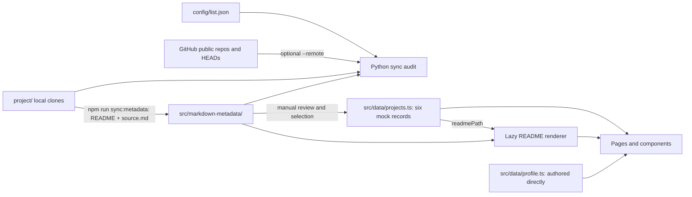

# Jakkarin's portfolio website

A GitHub-inspired portfolio that presents repositories as projects to explore. The familiar profile and repository layout stays, while project overviews and the original READMEs carry the explanation. Code browsing, commit history, and activity graphs are outside this site's intended experience.

The site is a React + TypeScript single-page app built with Vite. It currently shows six **mock preview records** while the complete catalog and project writing are prepared.

## Run locally

```bash
npm install
npm run dev
```

Open the local URL printed by Vite. `npm run build` runs TypeScript checks and creates a production bundle in `dist/`.

## Project hierarchy

```text
config/list.json                URL arrays: complete, profile, incomplete
config/list-detail.md           Project descriptions and priority notes
project/<repo-name>/             Untouched Git clones: 28 projects + 1 profile
src/markdown-metadata/<name>/   Repository Markdown snapshot and context
  README.md                     Verbatim root README copied from the clone
  cover.md                      Repository URL, GitHub description, topics
  short-description.md          Quick project context
  deep-description.md           Deeper context / source pointers
  source.md                     Clone commit, dates, snapshot time, README hash
src/data/
  projects.ts                   Six mock project records used by the website
  profile.ts                    Authored profile Overview, identity, and contact
src/pages/                     Route-level screens
src/components/                Shared layout and project presentation
src/styles.css                 Theme and page styles
scripts/sync-markdown-metadata.mjs  README snapshot/verification command
scripts/check_repository_sync.py   Inventory, commit, and README audit
```

The profile metadata folder currently contains only `README.md` and `source.md`; the website's profile Overview is authored directly in `src/data/profile.ts`. The 28 project metadata folders retain the four prepared Markdown files. `config/list.json` has explicit `complete`, `profile`, and `incomplete` arrays for 28 complete repos, the GitHub profile repo, and eight incomplete repos including this website. The incomplete links help check public profile coverage but need no metadata yet. Tiers live only in `config/list-detail.md`; they prioritize writing work and must never determine UI categories or ordering.

## Data architecture



`config/list.json` is the inventory for the audit, not the website's project catalog. The complete and profile arrays are expected to have clones and metadata; incomplete repos are tracked for GitHub profile coverage only. `config/list-detail.md` holds human notes and priority tiers. The audit checks its complete-project links, but neither config file feeds UI categories or ordering.

The clones are the primary reference and remain unchanged by these scripts. `src/markdown-metadata/` is the source of truth for repository content used by this portfolio. `source.md` records the checked-out Git commit, commit date, snapshot timestamp, and SHA-256 of the copied README. The cover and description files are separately prepared notes; the sync script copies **only README.md and source.md**. A matching commit and README hash do not prove those notes are current.

`src/data/` holds frontend-ready TypeScript objects. The six current records in `projects.ts` are intentionally mock data, not the full inventory, and are **not generated automatically** from metadata. Each record has a canonical `repositoryUrl` and a `readmePath` into metadata. The profile Overview is edited directly in `profile.ts` without an intermediate metadata file. Portfolio-specific category, overview, and highlights belong in this frontend layer as the catalog grows.

## Check and refresh repository data

1. Run `python scripts/check_repository_sync.py` for an offline audit. Add `--remote` to compare against current GitHub HEADs and all public repos on the profile; that mode needs network access. The audit reads the JSON arrays directly, checks `config/list-detail.md` coverage, and reports missing clones/metadata, commit differences, and README byte/hash differences. It never edits files. An offline clean result only means the metadata matches the **local checked-out clones**.
2. If GitHub is ahead, update the relevant clone through its normal Git workflow, then rerun the audit. For each changed commit, inspect the suggested `git -C project/<name> diff --stat <recorded-commit>..HEAD` and the full diff. Decide whether `cover.md`, `short-description.md`, `deep-description.md`, and the frontend record need revision, or whether the README alone changed.
3. After that review, run `npm run sync:metadata`. It copies changed root READMEs byte-for-byte and updates `source.md` when a clone commit or README changes. It does **not** update the other Markdown notes or `src/data/`. Clones remain untouched.
4. Run `python scripts/check_repository_sync.py`, `npm run check:metadata`, and `npm run build` to verify the resulting local snapshot and frontend. Use `--remote` again if the update was meant to catch up with GitHub.

The sync script and `check:metadata` reject a clone README with uncommitted changes. Both scripts use only the local clones; only the Python audit's `--remote` mode contacts GitHub.

To add a project to the website, inspect its metadata and clone, add a typed record to `src/data/projects.ts` with its real URL and README path, and then add portfolio-only writing to the data layer. The README renderer loads the referenced Markdown lazily and supports GitHub-flavored Markdown, sanitized inline HTML, and relative GitHub links/images.

## Frontend structure

- `src/App.tsx` defines routes, shared chrome, and theme state.
- `src/pages/OverviewPage.tsx` displays the authored profile introduction and pinned preview projects.
- `src/pages/RepositoriesPage.tsx` offers search, category filtering, sorting, a list view, and collapsible category groups.
- `src/pages/RepositoryDetailPage.tsx` places a portfolio `OVERVIEW.md` beside About, then shows the original README in a full-width block.
- `src/pages/JourneyPage.tsx` provides a short narrative through selected preview projects.
- `src/components/projects/RepositoryReadme.tsx` renders the selected metadata README. Other shared UI lives under `src/components/layout/` and `src/components/projects/`.

The detail `OVERVIEW.md` and Journey text still have page-level placeholder writing. The next content pass can move project-specific text into typed frontend data while keeping the original README snapshots intact. See `AGENTS.md` for the handoff and current limitations.
