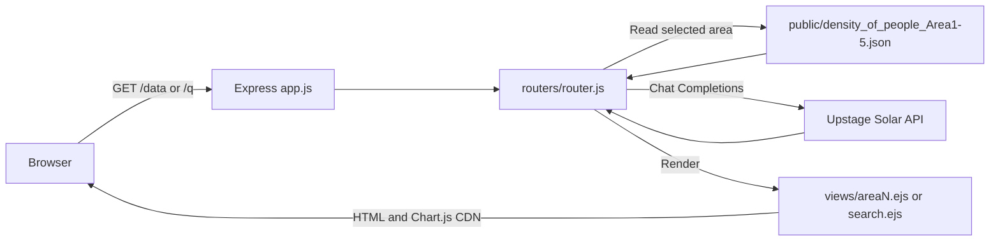
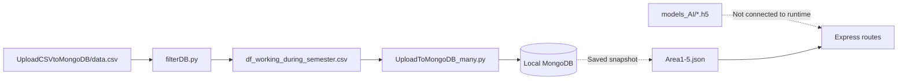

# PredictPeopleAssistant

This was a hackathon project I built at my first year of university. The idea was an assistant that would help staff see how many people were in each area and ask AI what to do next. The scope was bigger than what we could finish: the website had charts and a question-and-answer page, but the prediction model, database, and hosted backend never came together. This README records both the original idea and what the surviving code actually does. It is not a production-ready system.

## What the current code does

- Open `/data?area=1&idx=0` to see five people-count records from one of five area JSON files, plotted as a chart, with advice requested from Upstage Solar.
- Change `idx` to move the data window by **one record** at a time, or use the page buttons to switch areas.
- Enter a question on an area page to open `/q`, which displays the question and a response from Upstage.
- Open `/area1.html` through `/area4.html` to see older static mockups with hardcoded chart values.

The chart on `/data` uses saved sample data. It does **not** run the `.h5` model to make live predictions. Its X-axis labels (`now`, `10m next`, and so on) are fixed strings; the code does not check whether the timestamps in the JSON match those intervals.

## Run locally

You need Node.js and npm. The application uses Express and EJS, plus the OpenAI SDK configured to call Upstage Solar. To receive an AI response on `/data` or `/q`, provide a valid Upstage API key through `OPENAI_API_KEY`. That variable name comes from the SDK configuration even though the request goes to Upstage.

```powershell
npm ci
$env:OPENAI_API_KEY = "YOUR_UPSTAGE_API_KEY"
npm start
```

Then visit `http://localhost:3000/data?area=1&idx=0`. The root URL, `http://localhost:3000/`, only displays `Server running...`. The server uses port `3000`, and you should start it from the repository root because the routes read JSON files using paths relative to the working directory.

**Secret handling:** The repository's Git history already tracks a `.env` file. Do not commit a real API key again. If a real key was ever stored there, revoke or rotate it before sharing the repository. Removing the file from a later commit does not remove it from earlier Git history.

## What remains unfinished

| Part             | State in the code                                                                                                                                                                                                              |
| ---------------- | ------------------------------------------------------------------------------------------------------------------------------------------------------------------------------------------------------------------------------ |
| Prediction model | `models_AI/my_new_model_3_30.h5` and an experimental TensorFlow.js conversion script exist, but Express never loads or runs the model.                                                                                         |
| Database         | Python scripts prepare CSV data and upload it to local MongoDB. At runtime, the website reads `public/density_of_people_Area*.json` directly.                                                                                  |
| AI advice        | The routes call Upstage Solar, but the prompt contains hardcoded numbers for every area. They may not match the selected `area` and `idx`. If the API call fails, the page displays `Error during API request`.                |
| Deployment       | `vercel.json` exists, but the original README recorded server crashes when connecting MongoDB and Upstage on Vercel. The current `app.js` still calls `app.listen()` directly; successful deployment has not been established. |
| UI               | `/` has no dashboard link. The Search button in `areaN.ejs` sends the **next** area number instead of the current one. `public/search/search.js` refers to an `/ask` route that does not exist.                                |

The original notes say that the demo used precomputed data and a local server in place of the intended hosted system. That is project history, not a claim that the deployment has been tested recently.

## Key files

```text
app.js                           Starts Express, static files, routes, and EJS
routers/router.js                GET /, /data, /q, and the Upstage request
views/areaN.ejs                  Chart and question input
views/search.ejs                 Question-and-answer page
public/density_of_people_*.json Saved sample data for Areas 1–5
public/area*.html, area*.js      Earlier static mockups
UploadCSVtoMongoDB/              CSV files and data preparation/upload scripts
models_AI/                       .h5 model, not connected to the website
vercel.json                      Experimental deployment configuration
```

The [Architecture Guidebook](#architecture-guidebook) below explains the request flow, data flow, component responsibilities, and limitations.

## Technologies

The website uses Node.js, Express, EJS, Chart.js from a CDN, and the OpenAI SDK to call Upstage Solar. Data preparation scripts use Python, pandas, and PyMongo. The saved model is a Keras `.h5` file. Having a file or dependency in the repository does not mean that component is integrated into the website.

---

## Architecture Guidebook

This guide describes the architecture visible in the repository. It distinguishes the **intended design** from the **working request path**, so the saved charts are not mistaken for live model predictions.

### 1. Project goal

A staff member would choose an area, inspect the expected number of people, and ask an AI assistant how to respond. The intended pipeline was people-count data → prediction model → chart → AI advice, backed by a database and hosted online. The final prototype uses saved JSON snapshots in place of a runtime model and database connection.

### 2. Runtime overview



`app.js` serves files from `public/`, registers the router, configures EJS, and listens on port 3000. `routers/router.js` handles requests, reads JSON, prepares chart values, calls Upstage, and renders HTML. There is no scheduler, WebSocket, or model inference process in the Node.js runtime.

### 3. Request flow

| Route       | Input                                     | Behavior                                                                                                                                      | Output                                                     |
| ----------- | ----------------------------------------- | --------------------------------------------------------------------------------------------------------------------------------------------- | ---------------------------------------------------------- |
| `GET /`     | None                                      | Returns a basic server message.                                                                                                               | `Server running...`                                        |
| `GET /data` | `area` defaults to 1; `idx` defaults to 0 | Clamps `area` to 1–5, reads that area's JSON, takes up to five records starting at `idx`, and calls Upstage with a predefined staff question. | HTML from `views/areaN.ejs`, including a chart and advice. |
| `GET /q`    | `area`, `idx`, `q`                        | Reads the JSON and prepares `graphData`, but does not use that chart data in the prompt. Sends `q` and hardcoded people counts to Upstage.    | HTML from `views/search.ejs`.                              |

For example, `GET /data?area=2&idx=0` selects the first five records from Area 2. The chart values come from each record's `number_people` field. The labels `now`, `10m next`, `20m next`, `30m next`, and `60m next` are fixed; they are not calculated from `dater` and `time`.

`idx` is a record index, not a number of minutes. The “Go 10minutes future” button increases it by one, which moves to the next record only. Near the end of a file, the chart may receive fewer than five values. The code bounds numeric `area` and `idx` values but does not robustly reject `NaN` or fractional input.

Both `/data` and `/q` wait for Upstage before rendering. `handleChatAndPredict` sends a system message, a user message, and an assistant message containing hardcoded counts. Those counts do not come from the JSON just read, so the response can disagree with the chart. On an API failure, the helper returns an error string instead of advice, and the route still renders a page.

### 4. Data and model



The dotted MongoDB-to-JSON edge reflects the original README's explanation that data was exported from the database to temporary JSON files. **There is no export script in this repository**, so the complete CSV-to-JSON pipeline cannot be reproduced automatically from the saved code.

- `UploadCSVtoMongoDB/filterDB.py` uses pandas to select records that are not weekends or holidays and fall during the semester. It saves a 20-day sample starting at date index 80 in the script. It is not run when the website starts.
- `UploadToMongoDB_many.py` inserts the filtered CSV into the `Area5` collection on MongoDB at `localhost:27017`. `UploadToMongoDB_one.py` inserts a test record into the `test` collection. These standalone scripts are not used by the web routes.
- `public/density_of_people_Area1.json` through `Area5.json` are snapshots from different days. Records include `dater`, `time`, `number_people`, `is_weekend`, `is_holiday`, and a MongoDB Extended JSON `_id`. The five files contain 146, 144, 141, 139, and 103 records respectively. The repository does not provide location metadata for the areas.
- `models_AI/my_new_model_3_30.h5` is a saved Keras model, but the repository does not contain enough information to establish how well it performs or how it was trained. `UploadCSVtoMongoDB/chageModelForm` is an experimental TensorFlow.js conversion script. Nothing in `package.json` runs it, and the website loads no converted model.

### 5. User interface

`views/areaN.ejs` is the page used by `/data`. It builds a Chart.js chart from a CDN, provides area navigation, and includes a question input. Its Search button builds a `/q` URL with the area number increased by one, so the question may be associated with the wrong area.

`views/search.ejs` displays the question and answer rendered by the server. `public/search/search.js` appears to belong to an earlier UI: it looks for an `askButton` and calls `POST /ask`. The current template has no such button, and the router has no `/ask` endpoint.

`public/area1.html` through `area4.html`, with their matching JavaScript files, are static mockups. Their chart numbers are hardcoded and are unrelated to `/data` or the AI model. There is no `area5.html`, although an Area 5 JSON file exists.

### 6. Deployment and limitations

`vercel.json` routes requests to `app.js`, while `app.js` directly starts a local server with `app.listen()`. The original README reported failures when MongoDB and Upstage were connected on Vercel and said a local server was used for the demo. The current deployment state has not been verified on Vercel.

The main limitations visible in the code are:

1. The `.h5` model is never used for request-time inference; charts read saved snapshots.
2. AI prompts contain hardcoded counts that are disconnected from the displayed chart and require an external API key.
3. Routes use paths relative to the working directory and call Upstage on every request, so they depend on how the process is started and on an external service.
4. Input validation and end-of-file handling are incomplete.
5. `.env` and `node_modules` appear in Git history. Check credentials and dependency tracking before publishing or continuing development.

### 7. If development resumes

First, make the chart and AI prompt use the same data. Then validate `area` and `idx`, fix navigation in the EJS page, and show a clear fallback when Upstage is unavailable. After that, decide whether to integrate the `.h5` model and MongoDB or keep the project as a snapshot-based demo. Any future deployment should be tested on its actual hosting platform, with credentials removed from tracked files and rotated if they were exposed.

## License

Original code and documentation authored by Jakkarin Promsee are licensed under the [MIT License](LICENSE). Third-party code, assets, datasets, and other materials are not covered by this license; their original terms apply.
