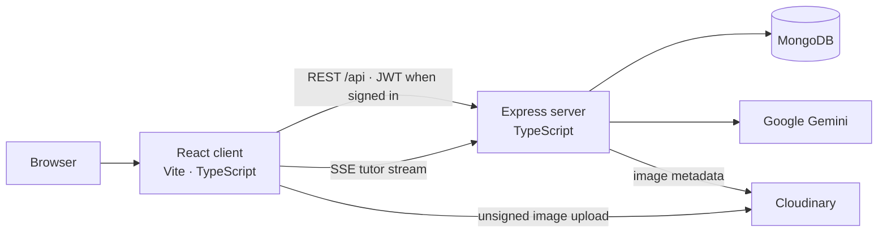

# 🥔 Hot Potato

**Teacher-led learning materials, an AI study companion, and room for every student to think out loud.**

Many students can read a handout but have no one available to ask *why*, test an idea with, or continue a conversation after an answer. That gap is wider for learners with limited access to teachers and tutoring. Hot Potato helps them practice critical thinking through teacher-authored lessons, questions that invite reasoning, and an AI study companion they can talk to freely.

**The teacher owns the material and the learning direction.** Teachers write or bring in their existing notes and worksheets, decide which AI suggestions to accept, and set how the tutor should respond for each lesson. The AI helps a teacher turn pasted material into a structured web lesson; for students, it is a friendly partner for open-ended questions and discussion, not the author of the curriculum. The Thai-first, phone-first student interface is designed so people with little tech experience can start reading and asking without an account.

**[Open the showcase](https://hot-potato-client.vercel.app/)** · [Student walkthrough](https://hot-potato-client.vercel.app/guide/learning) · [Teacher walkthrough](https://hot-potato-client.vercel.app/guide/creating)

This README is the **single entrance** to the product and the codebase. Start with the illustrated use cases, then use the [developer guidebook](#developer-guidebook) to work across all three repositories.


## Use cases

Hot Potato has two connected journeys. Teachers own the material, questions, and tutor guidance; students read it, try ideas, and talk with the AI companion on a phone or computer. The [client README](https://github.com/Jakkarin-Promsee/hot-potato-client#use-cases) contains every captured guide scene, while this page shows the main journey end to end.

The interface is Thai-first and can be switched to English. Screenshots show the Thai interface. They were captured at 2× resolution with Playwright from the running client and its seeded guide lesson. The landing image was recaptured from the current UI; the other scenes come from the client's [`capture-guide.mjs`](https://github.com/Jakkarin-Promsee/hot-potato-client/blob/main/scripts/capture-guide.mjs) workflow.

### Student: find a lesson and start reading

Open **Explore**, search for a public lesson, and select its card. Bookmark a lesson on the current device for later. The viewer keeps the teacher's text, media, and questions together. The student flow uses a Thai-first, phone-first interface with clear steps and no required sign-in for public lessons or AI chat—important for learners who are new to digital tools.

| Find a lesson | Read it |
| --- | --- |
|  |  |

### Student: answer, get feedback, and ask more

Questions can be multiple choice, written, drag to fill, or typed fill. Submit an answer to receive contextual feedback. Follow-up suggestions and the **Ask AI** button turn a lesson into a conversation: students can ask what confused them, test an idea, or explore a related topic instead of stopping at a right/wrong verdict. The tutor is designed to encourage reasoning rather than shame an incorrect answer. The server loads the teacher's lesson to ground its replies, while the teacher controls whether it should stay within that lesson or discuss related general knowledge.

| Answer a question | Read feedback | Ask the tutor |
| --- | --- | --- |
|  |  |  |

Written answers and fill-in-the-blank blocks use the same lesson flow:

| Written answer | Drag to fill |
| --- | --- |
|  |  |

Students can choose one of six tutor personalities. Signed-in students also get saved answers and learning history. Tutor memory can be viewed and erased from the profile; automatic memory updates are currently disabled by default on the server.


### Student: pick up where you left off

With an account, previously opened lessons appear in **History** and submitted answers can be restored. The profile exposes the tutor-memory sketch and a delete action. The memory feature is shelved by default, so new automatic sketches require an operator to enable `AI_MEMORY_ENABLED=true`.

| Learning history | Tutor memory |
| --- | --- |
|  |  |

### Teacher: build and publish a lesson

Sign in, create a lesson, then write in the desktop editor. Add rich text, images, drawings, formulas, and question blocks. To bring existing teaching material online with less manual rework, paste text from an old worksheet, Word document, or notes into **Import existing material**; the AI proposes a lesson structure and questions. It does not scan paper directly. The teacher previews and accepts every suggestion before it enters the document. The document autosaves, and the same blocks render in the student viewer.

At publication, choose **public**, **link-only**, or **private** access. The teacher can also guide the tutor's response style per lesson: add a persona note and custom guidelines, choose whether it may give direct answers, and decide whether it can discuss related general knowledge. The teacher remains responsible for what is taught; the AI helps prepare it and helps students think through it.

**Write the lesson:**


**Add media and formulas:**


**Add questions:**


**Use the AI copilot to structure existing material, draft, and review:**


**Set the tutor's guidance, publish, and share:**


## Developer guidebook

### 1. Work in the three-repository workspace

This root repository is the **integration map**. It contains the cross-cutting architecture, operational notes, and `graphify-out/`, a knowledge graph that connects client and server concepts. The client and server are independent deployable Git repositories. Keep this root checkout next to them when implementing a feature, especially one that crosses the API boundary.

| Repository | Owns | Start reading |
| --- | --- | --- |
| **This root repo** | System architecture, flows, testing/operations guidance, Graphify graph | This README → [`docs/ARCHITECTURE.md`](docs/ARCHITECTURE.md) → [`docs/data-flow.md`](docs/data-flow.md) |
| [**hot-potato-client**](https://github.com/Jakkarin-Promsee/hot-potato-client) | React app, routes, editor/viewer, state, browser-side API calls | [Client README](https://github.com/Jakkarin-Promsee/hot-potato-client#readme) → [client `CLAUDE.md`](https://github.com/Jakkarin-Promsee/hot-potato-client/blob/main/CLAUDE.md) |
| [**hot-potato-server**](https://github.com/Jakkarin-Promsee/hot-potato-server) | HTTP contract, auth, lesson storage, AI orchestration, persistence | [Server README](https://github.com/Jakkarin-Promsee/hot-potato-server#readme) → [server `CLAUDE.md`](https://github.com/Jakkarin-Promsee/hot-potato-server/blob/main/CLAUDE.md) |

A clone of this root repo **does not contain** client or server source: both nested folders are ignored here and have their own `.git` directories. To recreate the development layout:

```sh
git clone https://github.com/jakkarin-promsee/hop-potato-root.git Hot-Potato
cd Hot-Potato
git clone https://github.com/Jakkarin-Promsee/hot-potato-client.git client
git clone https://github.com/Jakkarin-Promsee/hot-potato-server.git server
```

Run Git commands from the repository that owns the files you changed. A root documentation change belongs to root; an editor change belongs to client; an API change belongs to server. A cross-cutting feature can require changes in all three.

### 2. Understand the system boundary



The client is a React 19 SPA with Vite, Tailwind, Zustand, TipTap, Fabric, and KaTeX. The server is Express 5 with Mongoose. In the configured deployment, Vercel serves the client, Render runs the API, MongoDB stores records, Cloudinary holds images, and Gemini produces AI replies. The **API contract** lives in `server/src/routes/*` and controllers; the client consumes it through stores and API helpers. The server's `.model.ts` files own the data contract.

The main paths through that boundary are:

| User action | Client entry and transport | Server and persistence |
| --- | --- | --- |
| Explore and open a lesson | `Explore.tsx` / `TiptapView.tsx` → `content.store.ts` → Axios | `GET /api/content/search`, `GET /api/content/load` → `content.controller.ts` → `Content` |
| Answer a question | `Question*View.tsx` → `content-answer.store.ts`; AI feedback through `tutorApi.ts` | `/api/content-answer/:contentId` saves signed-in answers; `/api/chat/tutor` builds feedback |
| Ask the tutor | Viewer/question UI → `tutorApi.ts` using `fetch` for SSE | `tutor.controller.ts` → `lessonContext.service.ts` → `services/tutor/*` → Gemini; `ChatSession` for signed-in history |
| Create and edit a lesson | `Create.tsx` / `TipTapCanvas.tsx` → `content.store.ts` | `POST /api/content/create`, `PUT /api/content/:id` → `Content`; updates use optimistic concurrency |
| Use teacher AI | Editor AI panels → `creatorApi.ts` | `POST /api/creator/assist` → `services/creator/*`; client previews results before insertion |
| Sign in | `Login.tsx` → `auth.store.ts` → `axios.ts` | `/api/auth/*` → JWT and user records; authenticated calls attach a Bearer token |

The full route/guard table is in the [server README](https://github.com/Jakkarin-Promsee/hot-potato-server#api-reference); the detailed call sequences are in [`docs/data-flow.md`](docs/data-flow.md). Streaming AI intentionally uses `fetch` rather than Axios, so check both transports when changing auth, errors, or base URLs.

### 3. Preserve the product rules

1. **Public learning and AI work without an account.** Public-content reads and tutor calls use optional authentication. Signing in adds persistence; do not put a login guard on public lessons or AI.
2. **Do not ration real students' AI use.** Rate limiting is a generous bot-abuse guard, not a student quota or paywall.
3. **The TipTap document is the lesson's source of truth.** Question definitions, canvas state, formulas, and other block data belong in node attributes so autosave and the read-only viewer share the same document.
4. **The server owns AI lesson context.** The browser sends an ID and the current turn; `lessonContext.service.ts` loads and serializes the trusted lesson. Do not send a client-built copy of lesson text as the AI source.
5. **Teacher AI requires preview and acceptance.** The copilot proposes content; the teacher decides what enters the editor. Validate generated question data before insertion.
6. **Keep the student path usable for low-tech learners.** Preserve clear, phone-first navigation, Thai-first copy, visible feedback, and the ability to begin without an account.
7. **The teacher controls instructional intent and the tutor's style.** Imported material and AI drafts require teacher approval; per-lesson `agent_settings` shape the tutor's voice, directness, scope, and guidelines.

These rules are explained with failure modes in [`docs/ARCHITECTURE.md`](docs/ARCHITECTURE.md), with guard placement in [`docs/security-model.md`](docs/security-model.md), and with request lifecycles in [`docs/data-flow.md`](docs/data-flow.md).

### 4. Use Graphify to locate cross-repo code

The checked-in [`graphify-out/graph.html`](graphify-out/graph.html) is a visual map; [`graphify-out/GRAPH_REPORT.md`](graphify-out/GRAPH_REPORT.md) describes its communities and build provenance. If the Graphify CLI is available, query relationships before changing a flow:

```sh
graphify query "how does a student question reach the tutor and save feedback"
graphify path "QuestionChoiceView" "tutor.controller.ts"
graphify explain "lessonContext.service.ts"
```

Use the result to find **both ends** of an interaction, then read those files and their local `CLAUDE.md` instructions. The graph is a navigation aid, not a substitute for current source: its report records the build revision, and later code changes can make some nodes or edges stale. Rebuild it after major structural changes; routine work can query the existing graph.

### 5. Run the complete app locally

Use Node.js **20.19+ or 22.12+** and npm. The server needs MongoDB, a JWT secret, and a Gemini API key for live AI. Cloudinary credentials enable image uploads; Google sign-in needs a matching Web client ID in both halves. Keep secrets in ignored `.env` files. The [server environment table](https://github.com/Jakkarin-Promsee/hot-potato-server#environment-variables) and [client environment table](https://github.com/Jakkarin-Promsee/hot-potato-client#getting-started) document the complete options.

In `server/.env`, start with:

```env
PORT=5000
MONGO_URI=mongodb://127.0.0.1:27017/hot-potato
JWT_SECRET=replace-with-a-long-random-secret
GEMINI_API_KEY=your-gemini-key
CORS_ORIGINS=http://localhost:5173
CLOUDINARY_CLOUD_NAME=your-cloud-name
CLOUDINARY_UPLOAD_PRESET=your-unsigned-preset
```

In `client/.env`, point Vite at that API and use the same Cloudinary account:

```env
VITE_API_URL=http://localhost:5000
VITE_CLOUDINARY_CLOUD_NAME=your-cloud-name
VITE_CLOUDINARY_UPLOAD_PRESET=your-unsigned-preset
```

Install and start each half in its own terminal:

```sh
cd server
npm install
npm run dev
```

```sh
cd client
npm install
npm run dev
```

Open `http://localhost:5173`. The API defaults to `http://localhost:5000`; `GET /api/status/all` provides a public health view. Creating lessons requires sign-in, while exploring public lessons and using their AI tutor does not. The teacher editor targets desktop; student reading and chat are phone-first.

### 6. Implement a change across the boundary

Start with the user journey and trace it in the graph and [`docs/data-flow.md`](docs/data-flow.md). Then use the relevant path below:

| Change | Where to implement | What to verify |
| --- | --- | --- |
| **New API field or endpoint** | Server route → controller → model/service, then client store/helper and consuming UI | Request/response shape, guard level, anonymous behavior, both test suites |
| **New lesson block** | TipTap extension/node attrs → editor controls → read-only viewer → server `lessonContext.service.ts` serialization when AI needs it | Save/reload, viewer rendering, AI context, old documents |
| **Tutor behavior** | `client/.../tutorApi.ts` → `/api/chat/tutor` → `services/tutor/*` | All four modes, SSE and JSON fallback, anonymous `clientThread`, logged-in sessions |
| **Teacher copilot action** | Editor AI panel / `creatorApi.ts` → `/api/creator/assist` → creator prompt/parser/validator | Preview/accept boundary, malformed output, owner/collaborator guard |
| **Auth or access** | Client route guard and Axios/fetch paths → server auth middleware and content access checks | Logged-in and anonymous paths, 401 handling, public/link-only/private lessons |

Keep the root docs in sync when a change alters a system rule or cross-repo flow. More focused maps are in [`docs/ui-structure.md`](docs/ui-structure.md), [`docs/ui-state.md`](docs/ui-state.md), [`docs/data-model.md`](docs/data-model.md), and the product repositories' `CLAUDE.md` files.

### 7. Verify before calling a feature done

Run both offline suites for a cross-repo change, plus build/lint where relevant:

```sh
(cd server && npm test && npm run build)
(cd client && npm test && npm run lint && npm run build)
```

The server suite uses Supertest, an in-memory MongoDB, and a mocked Gemini client. The client uses Vitest and happy-dom. Live Gemini checks (`server/npm run test:ai`) require a real key and spend tokens; reserve them for an AI release boundary. For manual smoke testing, exercise a public lesson **both signed in and anonymously**, then create/edit/publish as a teacher. Watch `/status` and `/api/status/all` when diagnosing API or AI failures. See [`docs/testing.md`](docs/testing.md) and [`docs/operations.md`](docs/operations.md) for the complete checks.

README screenshots come from the client's Playwright guide pipeline (`client/scripts/seed-guide-demo.mjs` and `client/scripts/capture-guide.mjs`); the landing shot was refreshed with `client/scripts/capture-readme-landing.mjs`. The seeded workflow writes demo records to whichever database the local API points at, so use a disposable demo database when recapturing scenes. Source screenshots live in the client repo; selected copies are committed here because this root repo has its own Git history.

### 8. Documentation and current status

| Read | For |
| --- | --- |
| [`AGENT.md`](AGENT.md) and [`CLAUDE.md`](CLAUDE.md) | Agent workflow, Git boundaries, product principles |
| [`docs/README.md`](docs/README.md) | Index of system-level documentation |
| [`docs/ARCHITECTURE.md`](docs/ARCHITECTURE.md) | Mental model and load-bearing decisions |
| [`docs/data-flow.md`](docs/data-flow.md) | Concrete auth, lesson, answer, tutor, and copilot flows |
| [`docs/security-model.md`](docs/security-model.md) | Route guards, JWT behavior, CORS, and privacy |
| [`docs/testing.md`](docs/testing.md) and [`docs/operations.md`](docs/operations.md) | Verification, deployment setup, health checks, and incidents |
| [Client README](https://github.com/Jakkarin-Promsee/hot-potato-client#readme) / [Server README](https://github.com/Jakkarin-Promsee/hot-potato-server#readme) | Repo-specific commands, scripts, API details, and all client screenshots |

The core teacher and student flows are implemented. The [showcase](https://hot-potato-client.vercel.app/) is the place to try the interface; local source and configuration remain the authority for implementation details.

## License

Original code and documentation authored by Jakkarin Promsee are licensed under the [MIT License](LICENSE). Third-party code, assets, datasets, and other materials are not covered by this license; their original terms apply.
