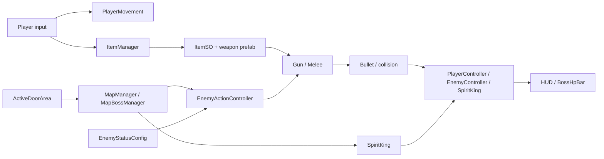

# Rebirth

**A 2D pixel-art action game about escaping a prison, fighting the Spirit King's forces, and choosing how the story ends.** Move, dash, aim manually, trade weapons, clear enemy waves, and survive a multi-phase boss encounter.

<div align="center">

[**▶ Play Rebirth in your browser**](https://nightst.itch.io/rebirth)

<a href="https://youtu.be/ZhlghJ0V2-c"></a>

**▶ [Watch the full gameplay showcase on YouTube](https://youtu.be/ZhlghJ0V2-c)**

</div>

## At a glance

- **Combat:** seven equipable weapons, manual mouse aim, recoil and knockback, projectile collision, and a shield-powered sword reflection.
- **Enemy movement:** patrol, direct pursuit, orbital strafing, short unpredictable repositioning, and lateral dodges. Each archetype tunes the same controller with a `ScriptableObject`.
- **Progression:** tilemap rooms close their doors on entry, spawn waves on available floor tiles, and reopen after the room is cleared. Treasure rooms offer more weapons.
- **Boss:** the Spirit King follows a separate navigation and attack system, with telegraphed area attacks and three attack sequences selected by remaining HP.
- **Story:** a Mystery Man encounter records a choice used by the ending flow.

## Play and controls

Play the [HTML5 build on itch.io](https://nightst.itch.io/rebirth). The controls below follow the checked-in player code and prefab:

| Input | Action |
| --- | --- |
| `W` `A` `S` `D` | Move |
| Mouse | Aim equipped weapon |
| Hold left mouse button | Fire or swing |
| `Space` or right mouse button | Dash |
| `1` `2` `3` or `R` | Select an inventory slot / cycle weapons |
| `E` | Pick up a nearby weapon |
| `G` | Drop the equipped weapon |
| `F` | Reflect projectiles while holding the sword and having shield; advance Mystery Man dialogue when active |

The inventory has three slots. Picking up a fourth weapon drops the currently equipped one. Health and shield appear in the HUD; the third meter tracks dash availability (named `mana` in `PlayerController`). The published itch.io page has a slightly different control list, so use the game build's behavior if it differs from this checkout.

## Arsenal

The seven player weapons are registered in [`ItemManager`](Assets/Scripts/Manager/ItemManager.cs). Each pickup has an [`ItemSO`](Assets/Scripts/Items/ItemSO.cs), while its combat behavior and values come from a weapon prefab plus a `RangeWeaponConfig` or `MeleeWeaponConfig` asset. The values below are the **player weapon config assets in this repository**, not promises about a separately deployed build.

| Weapon | Identity | Base damage | Fire interval |
| --- | --- | ---: | ---: |
| [Sword](Assets/Images/TestWeaponImage/Sword.png) | Close-range swing; `F` activates shield-consuming projectile reflection | 10 | Swing delay 0.3 s |
| [Pistol](Assets/Images/TestWeaponImage/Pistol.png) | Deliberate single shots | 40 | 0.4 s |
| [AK](Assets/Images/TestWeaponImage/AK.png) | Rapid fire | 25 | 0.2 s |
| [Shotgun](Assets/Images/TestWeaponImage/Shotgun.png) | Spread pellets plus the inherited gun shot | 20 per projectile | 0.7 s |
| [Bow](Assets/Images/TestWeaponImage/Bow.png) | Fast arrow projectile | 40 | 0.5 s |
| [Magic Orb](Assets/Images/TestWeaponImage/MagicOrb.png) | Piercing projectile (`isMoveThroughObject`) | 25 | 0.5 s |
| [Rocket Launcher](Assets/Images/TestWeaponImage/RocketLuancher.png) | Rocket impact and burn effect on enemies | 30 on impact | 1.0 s |

`Gun` instantiates the configured bullet, applies fire timing and recoil for player-owned weapons, and marks the projectile with its owner tag. `Bullet` handles travel, hit detection, damage, knockback, impact effects, and lifetime. `Shotgun`/`ShotgunBullet` add spread; the rocket bullet adds a burn coroutine; `Melee` controls swing collision and reflection. Enemy-owned weapons use separate config assets under [`EnemyRangeWeaponConfig`](Assets/ScriptableObjects/EnemyRangeWeaponConfig) and [`EnemyMeleeWeaponConfig`](Assets/ScriptableObjects/EnemyMeleeWeaponConfig).

## Enemies

Five regular-enemy prefabs share [`EnemyActionController`](Assets/Scripts/Enemy/EnemyActionController.cs), [`EnemyController`](Assets/Scripts/Enemy/EnemyController.cs), and [`EnemyWeaponAim`](Assets/Scripts/Enemy/EnemyWeaponAim.cs). Their [`EnemyStatusConfig`](Assets/Scripts/Scriptable/EnemyStatusConfig.cs) assets supply the weapon, engagement ranges, movement speeds, durations, and cooldowns.

| Enemy prefab | Weapon style | Sight range | Attack / chase range | Base attack cooldown |
| --- | --- | ---: | ---: | ---: |
| [Sword Enemy](Assets/Prefabs/Enemy/Sword%20Enemy.prefab) | Melee pursuit | 16 | 5 / 5 | 3 s |
| [Pistol Enemy](Assets/Prefabs/Enemy/Pistol%20Enemy.prefab) | Mid-range gunfire | 14 | 10 / 10 | 3 s |
| [Shortgun Enemy](Assets/Prefabs/Enemy/Shortgun%20Enemy.prefab) | Close-range spread | 16 | 8 / 8 | 5 s |
| [AK Enemy](Assets/Prefabs/Enemy/AK%20Enemy.prefab) | Sustained gunfire | 16 | 12 / 12 | 2 s |
| [Bow Enemy](Assets/Prefabs/Enemy/Bow%20Enemy.prefab) | Longer-range shots | 18 | 14 / 14 | 5 s |

These are serialized asset values. Actual attack and movement timing varies because the controller applies random cooldown and duration multipliers. `EnemyController` handles HP, hit flashes, burn damage, and a random close-guard visual variant.

### How regular enemies move

This is the core of the regular-enemy AI. The controller chooses a state in `Update`, writes a velocity to `Rigidbody2D`, and applies a friction force. It **does not use a `NavMeshAgent`**; the boss does.

```text
Idle / Patrol
    └─ player enters eyeRange, or enemy is hit → Chase
Chase
    ├─ player outside chaseRange → move directly toward player
    ├─ player inside chaseRange → Circle or Random reposition
    ├─ player inside dodgeRange, or enemy HP < 20 → Dodge
    └─ player inside attackRange and cooldown ready → attack, then Chase
Circle / Random ─ duration, destination, or stuck check → Chase
Dodge ─ dodge duration ends → Chase
```

1. **Patrol:** choose one of four cardinal directions near the spawn point, walk to it, return to spawn, and wait a randomized patrol cooldown. `eyeRange` or a hit wakes the enemy.
2. **Pursuit:** outside `chaseRange`, velocity points directly at the player. Inside it, the controller attempts its movement patterns instead of simply closing distance.
3. **Orbit (`Circle`):** pick a radius and clockwise/counterclockwise direction, advance an angle around the player's position captured at the start of the move, then reverse direction for a second timed segment. This creates strafing around an encounter point; the orbit center is not continuously updated to the moving player.
4. **Random reposition (`Random`):** choose a short offset, move toward it, and usually move partway back. Getting within 5 units of the player can end this pattern early and make circling available again.
5. **Dodge:** when close enough and off cooldown, or below 20 HP, move at a random `±dodgeAngle` from the player-facing direction for `dodgeDuration`. The default angle is 90°, producing a sideways evasive step.
6. **Attack and recovery:** attack is allowed inside `attackRange` when its cooldown expires. The cooldown and movement durations are varied per enemy, and a short knockback lockout lets hits interrupt velocity changes. A periodic position check ends a pattern if the enemy appears stuck against a wall.

The enemy config exposes `eyeRange`, `attackRange`, and `chaseRange` separately, plus patrol/orbit/random/dodge speeds and timers. The asset author's intended tuning order is `eyeRange > attackRange > chaseRange` and `chaseRange > circleRadius`; the current archetype assets set attack and chase ranges equal. [`EnemyWeaponAim`](Assets/Scripts/Enemy/EnemyWeaponAim.cs) rotates the equipped weapon toward the player every 0.2 seconds after activation. Because this movement is velocity based, obstacles can still block an enemy; the wall check exits a stalled movement state rather than calculating a path around the obstacle.

### Spirit King

The [Spirit King prefab](Assets/Prefabs/Boss/Spirit%20King.prefab) uses [`Spirit King.cs`](Assets/Scripts/Boss/Spirit%20King.cs), a 2D-configured Unity `NavMeshAgent`, and a separate attack state machine. Its chase helper sets a destination toward the player and stops when it reaches the requested range. The boss has a telegraphed normal strike and six scripted skills:

| Attack | Showcase behavior |
| --- | --- |
| Normal attack | Warning zone followed by a melee area strike |
| Skill 1 | Telegraph a direction, dash, and create an impact area |
| Skill 2 | Directional warning and laser line |
| Skill 3 | Dash and larger sword/area strike |
| Skill 4 | Mark ground positions and drop meteors |
| Skill 5 | Arena-scale warning and sweeping laser |
| Skill 6 | Mark valid floor positions and summon regular enemies |

Attack sequences are defined by `phase1`, `phase2`, and `phase3` arrays in the boss component. Code switches to phase 2 below **80% HP** and phase 3 below **40% HP**. Coroutines coordinate warning flashes, animations, damage windows, cooldowns, and camera shake. [`AreaAttack`](Assets/Scripts/Boss/AreaAttack.cs) tracks players inside a telegraph, while [`BossAreaAttack`](Assets/Scripts/Boss/BossAreaAttack.cs) applies repeated damage inside an active area.

## Architecture guide

### Runtime flow



| Area | Main files | Responsibility |
| --- | --- | --- |
| Player | [`PlayerMovement`](Assets/Scripts/Manager/MovementManager.cs), [`PlayerController`](Assets/Scripts/Player/PlayerController.cs), [`HUD_Controller`](Assets/Scripts/Player/HUD_Controller.cs) | Movement/dash, damage and shield regeneration, UI updates through `OnStatsChanged` |
| Inventory | [`ItemManager`](Assets/Scripts/Manager/ItemManager.cs), [`ItemSO`](Assets/Scripts/Items/ItemSO.cs), [`ItemPickable`](Assets/Scripts/Items/ItemPickable.cs) | Three-slot inventory, pickup/drop/equip, item metadata |
| Combat | [`Weapon`](Assets/Scripts/Weapon), [`Bullet`](Assets/Scripts/Bullet), [`Explosion`](Assets/Scripts/Explosion) | Weapon behavior, projectiles, hit effects, burn/fire areas |
| Regular enemies | [`Enemy`](Assets/Scripts/Enemy), [`EnemyStatusConfig`](Assets/Scripts/Scriptable/EnemyStatusConfig.cs) | State-driven movement, aiming, health, data-driven tuning |
| Rooms | [`MapManager`](Assets/Scripts/Manager/MapManager.cs), [`ActiveDoorArea`](Assets/Scripts/Map/ActiveDoorArea.cs), [`TreasureRoom`](Assets/Scripts/Map/TreasureRoom.cs) | Door triggers, tilemap-based wave spawns, rewards |
| Boss | [`Boss`](Assets/Scripts/Boss), [`MapBossManager`](Assets/Scripts/Manager/MapBossManager.cs) | Navigation, phases/skills, arena entry, boss HP and ending UI |
| Narrative | [`MysteryMan`](Assets/Scripts/Dialog/MysteryMan.cs) | Dialogue and choice stored on `PlayerController.ending` |

### Room and combat lifecycle

1. [`ActiveDoorArea`](Assets/Scripts/Map/ActiveDoorArea.cs) detects the player entering a room, closes its door, and activates regular enemies or the boss.
2. `MapManager` tracks placed enemies and spawned wave enemies. When the counts fall low enough, it picks random floor cells from `groundTilemap` excluding `obstructionTilemap`, then spawns the next wave. Once all configured waves and enemies are gone, it marks the room clear and reopens the door.
3. `TreasureRoom` reacts to the cleared state and spawns its configured weapon rewards when the player approaches. `ItemManager` converts a pickup's `ItemSO.itemName` to the corresponding equipable prefab.
4. A weapon instantiates a projectile or enables a melee collider. Collision routes damage and knockback to `EnemyController`, `PlayerController`, or `SpiritKing`. The HUD subscribes to the player's stat change event; the boss HP bar listens to boss HP changes.
5. In the boss room, `MapBossManager` activates the boss and shows its HP bar. After the boss object is destroyed, it displays an ending panel based on `PlayerController.ending`, which the Mystery Man choice sets.

### Adding content

**New ranged weapon:** create a `RangeWeaponConfig` with a bullet prefab, damage, fire interval, speed, recoil, and optional explosion; create a weapon prefab with `Gun` (or a subclass), `gunPoint`, animator, and `ItemPickable` referencing a new `ItemSO`. Register its name and prefab in `ItemManager` and its UI/inventory wiring. The current inventory uses a hard-coded name-to-prefab dictionary, so adding only an `ItemSO` is insufficient.

**New regular enemy:** create an `EnemyStatusConfig` that references the desired weapon prefab and melee/ranged config; create an enemy prefab with `EnemyController`, `EnemyActionController`, `Rigidbody2D`, animator, sprite, and weapon pivot. Add it to a room's `MapManager.enemyPrefab` list if it should appear in waves. Tune sight, attack, and chase ranges first, then orbit, random-move, dodge, and cooldown values.

**New room or boss attack:** room spawning needs ground and obstruction tilemaps, enemy prefabs, wave counts, placed-enemy references, door objects, and an `ActiveDoorArea`. Boss moves are coroutine-driven in `Spirit King.cs`; add the attack enum/coroutine, its telegraph and damage prefabs, and an entry in the desired phase arrays.

### Repository map and setup

```text
Assets/
  Scripts/             Player, weapons, bullets, enemy AI, boss, rooms, items
  ScriptableObjects/   Serialized weapon, enemy, and item configurations
  Prefabs/             Player, five regular enemies, boss, weapons, projectiles
  Scenes/              Main scene plus test/backup scenes
  Animations/          Character, weapon, projectile, and environment animations
  Images/              UI and weapon artwork
Packages/              Unity package manifest
ProjectSettings/       Unity project and build configuration
submodule/             NavMeshPlus checkout
```

Open the project with **Unity 2022.3.51f1** (the version in [`ProjectVersion.txt`](ProjectSettings/ProjectVersion.txt)). The enabled build scene is [`Assets/Scenes/TileMap1.unity`](Assets/Scenes/TileMap1.unity). The project uses **Universal Render Pipeline 14.0.11**, **Input System 1.11.2**, Unity 2D/tilemaps, and `NavMeshPlus` for 2D navigation assets. If cloning from Git, initialize submodules (`git submodule update --init --recursive`) before opening Unity. The repository includes both `submodule/NavMeshPlus` and `Assets/Submodule/NavMeshPlus` references in `.gitmodules`; check their state if the editor reports missing navigation scripts. The scene/prefab setup and editor play mode have **not** been verified in this checkout; the published browser build is the quickest way to play.

## Credits and license

Made by **nightst and collaborators**. The project includes third-party asset directories such as `KrishnaPalacio`, `Warped Shooting Fx`, and `NavMeshPlus`; consult their original license terms before reusing those assets. Repository source is accompanied by the [MIT license](LICENSE).

Original code and documentation authored by Jakkarin Promsee are licensed under the [MIT License](LICENSE). Third-party code, assets, datasets, and other materials are not covered by this license; their original terms apply.
